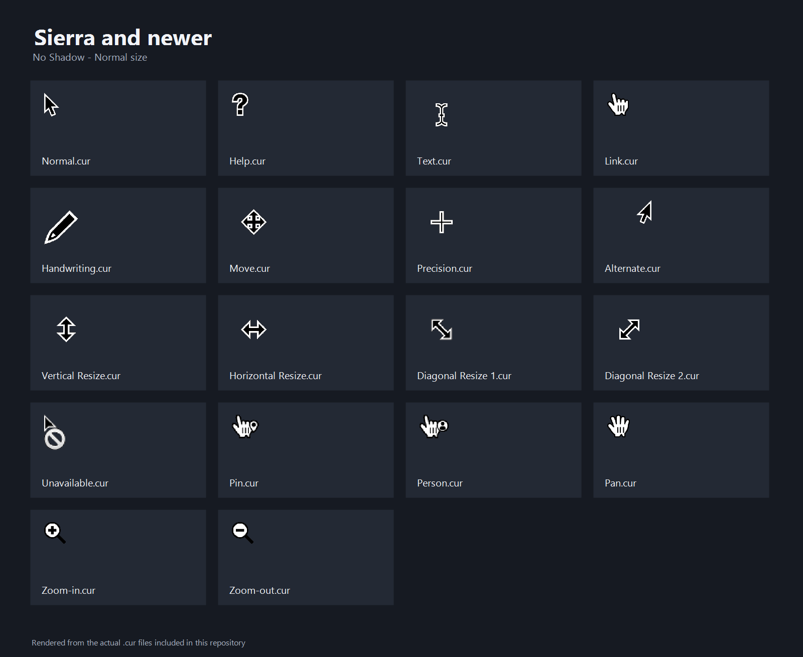
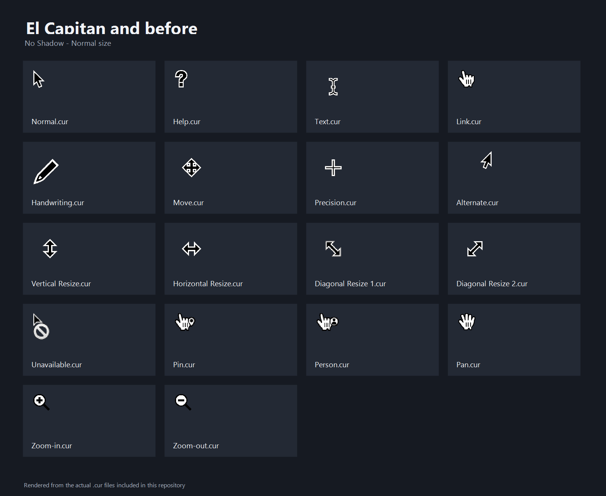
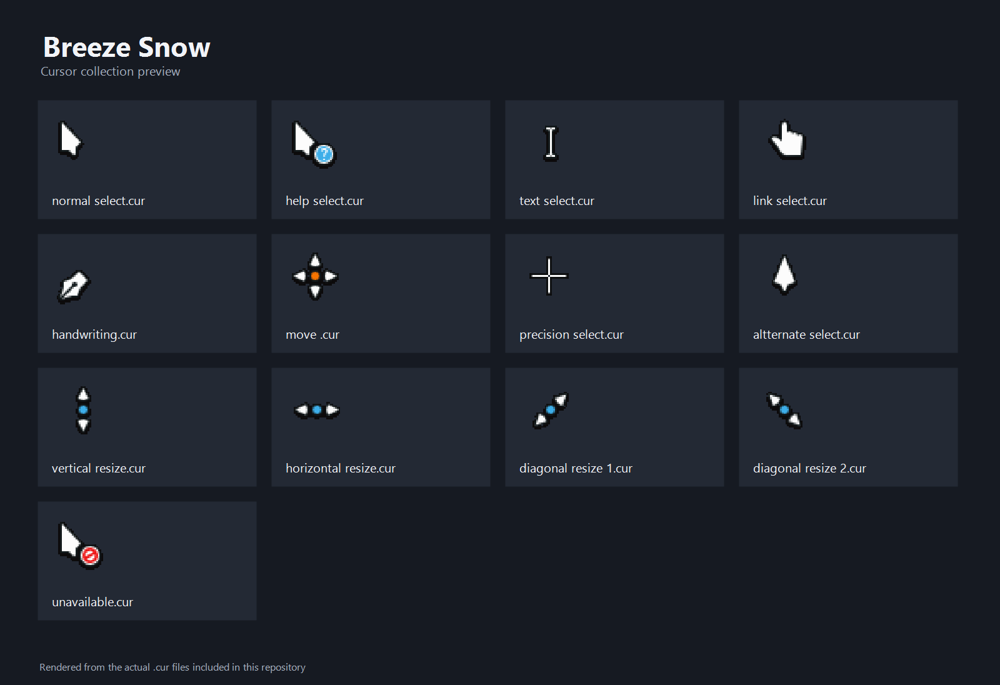
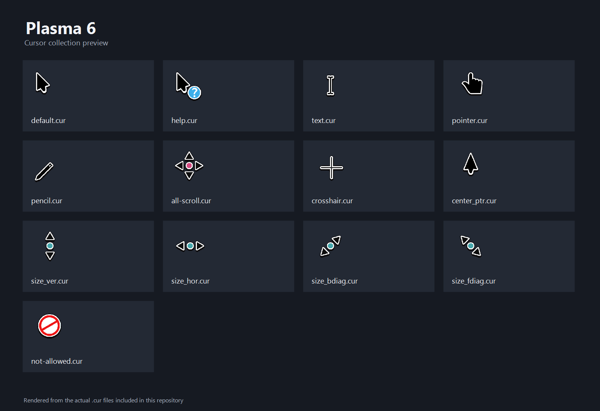

# macOS & CachyOS Cursors for Windows

A collection of cursor themes for Windows, bringing together macOS-style cursor sets and Linux desktop cursor themes adapted for Windows.

## Project overview

The repository is organized into four main collections:

| Folder | Description |
| --- | --- |
| `1. Sierra and newer` | macOS-style cursors for newer macOS versions (Sierra and later). |
| `2. El Capitan and before` | macOS-style cursors based on older macOS versions (El Capitan and earlier). |
| `3. Breeze Snow` | Breeze Snow cursor theme. |
| `4. Plasma 6` | Breeze cursor theme from KDE Plasma 6. |

## Cursor previews

The preview sheets below are rendered from the actual `.cur` files included in this repository.

### 1. Sierra and newer

### 2. El Capitan and before

### 3. Breeze Snow

### 4. Plasma 6

The macOS preview sheets show the **No Shadow / Normal** variant as a representative sample. Other shadow and size variants are available in their respective folders.

### macOS cursor variants

The first two collections provide several variants:

- **No Shadow** — cursor artwork without a drop shadow.
- **With Shadow** — cursor artwork with a drop shadow.
- **Normal** — standard cursor size.
- **Large** — larger cursor size.
- **XtraLarge** — extra-large cursor size.

Each variant folder contains its own `install.inf` file and the cursor assets required by that scheme.

## Installation

These instructions apply to Windows 10 and Windows 11.

### 1. Choose a cursor theme

1. Open the project folder.
2. Browse to the collection you want to install.
3. For the macOS collections, choose either **No Shadow** or **With Shadow**, then select **Normal**, **Large**, or **XtraLarge**.
4. Open the selected variant folder and locate `install.inf`.

For **Breeze Snow** or **Plasma 6**, open the corresponding folder directly.

### 2. Install the cursor scheme

1. Right-click `install.inf`.
2. Select **Install**. On Windows 11, you may need to select **Show more options** first if Install is not shown in the compact context menu.
3. Approve the Windows security prompt if one appears.
4. Wait for the installation to finish.

The INF installer copies the cursor files to the Windows Cursors directory and registers the cursor scheme for the current user. Keep the cursor files together in their original theme folder until installation is complete.

### 3. Apply the cursor scheme

1. Press **Win + R**.
2. Enter `main.cpl` and press **Enter**.
3. Open the **Pointers** tab.
4. In the **Scheme** drop-down, select the newly installed cursor scheme.
5. Select **Apply**, then **OK**.

If the scheme does not appear immediately, close and reopen the Mouse Properties window. You can return to **Pointers** at any time to choose another installed scheme or restore the Windows default.

## Notes

- Install one variant at a time. You can install multiple schemes, but choose the one you want from the **Pointers** tab.
- The INF files configure the cursor scheme; the `.cur` and `.ani` files are the actual static and animated cursor assets.
- Do not rename or move cursor asset files before running the installer, because the INF files refer to those filenames.
- Some themes may not define every pointer role. Windows may retain or use a fallback cursor for roles not included in a theme.
- This project is intended for Windows. The cursor files may originate from other desktop environments, but the included INF files provide Windows installation.

## Credits and licensing

This repository contains cursor artwork from different sources and projects. Original authors and license terms may differ between collections. Please retain applicable attribution and check the license or source information included with each collection before redistributing, modifying, or using its artwork in other projects.

The Breeze Snow folder includes source and license information in its `readme.txt`. Its included notice describes a custom license permitting personal, non-commercial use; contact the relevant author for other uses.

---

Enjoy your new cursors!
